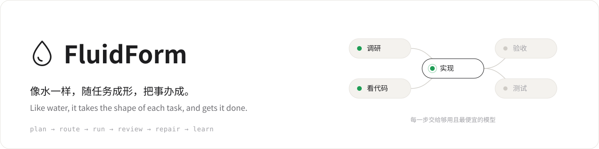
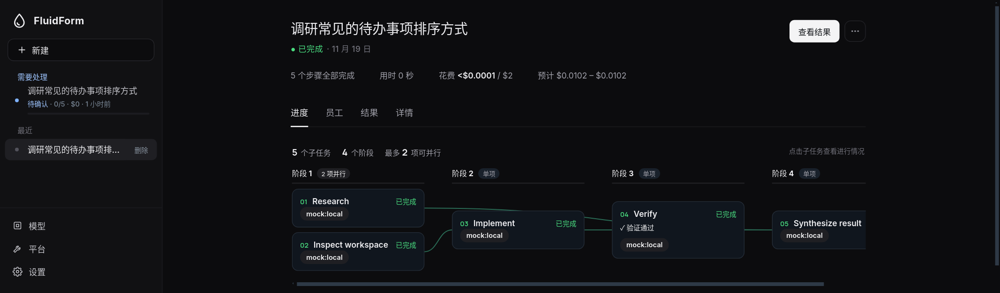
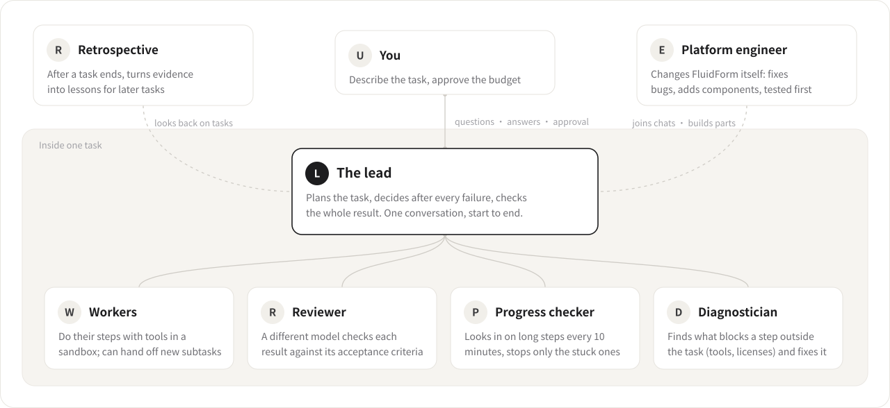
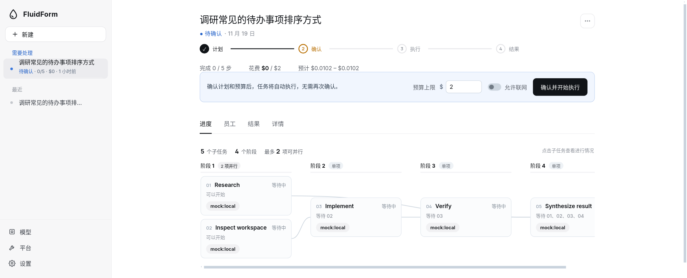
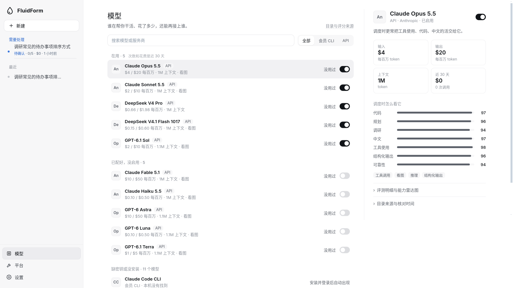
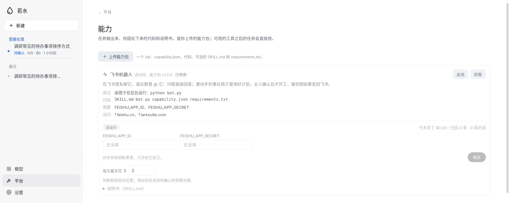

<p align="center"></p>

<p align="center">
  <b>Like water, it takes the shape of each task: a small team of AI models that gets it done on your own machine.</b>
</p>

<p align="center">
  <a href="#quick-start">Quick start</a> ·
  <a href="docs/guide.md">Guide</a> ·
  <a href="docs/ARCHITECTURE.md">Architecture</a> ·
  <a href="README.zh-CN.md">简体中文</a>
</p>

<br>

You say what needs doing and confirm the plan and budget once. A lead plans, workers split the
steps, a different model reviews each result, and when something blocks the work it is diagnosed
and repaired. The team comes back to you only when it really needs you.

<p align="center"></p>

## Highlights

<table>
<tr>
<td width="50%" valign="top">

**Confirm once, it works on its own**<br>
Plan, budget and network access are approved once. Retrying, switching models and changing the plan are the lead's calls, each with its reason.

</td>
<td width="50%" valign="top">

**The cheapest model that is good enough, per step**<br>
Models are picked by public benchmark results. The membership CLIs you already pay for (Claude Code, Codex, Gemini, Qwen) work alongside nine API providers.

</td>
</tr>
<tr>
<td valign="top">

**A different model checks the work**<br>
Every step's result is checked against its acceptance criteria by another model. Long steps are looked in on, and only the ones that are really stuck are stopped.

</td>
<td valign="top">

**It repairs its environment, and itself**<br>
A diagnostician fixes missing tools, licenses and ports. Defects in the platform go to a platform engineer, who fixes them in an isolated copy, and the fix applies only after its tests pass.

</td>
</tr>
<tr>
<td valign="top">

**Pluggable capabilities**<br>
Tools a task built can be kept. Capability packages are uploaded and uninstalled on their own, and run in a sandbox that reaches only the hosts they declare.

</td>
<td valign="top">

**Your data stays here**<br>
It answers only local requests, and tasks are offline by default. Steps run in a sandbox that cannot see your home folder. Keys are kept in the OS keyring.

</td>
</tr>
</table>

## The team

<p align="center"></p>

Each role is played by a model you configured. The code only keeps the guardrails: budget,
sandbox and permissions, network access, and retry limits. How each role works:
[Guide · Meet the team](docs/guide.md#meet-the-team).

## A look inside

| Confirm the plan and budget once | Models: in use, set up, missing a key |
|---|---|
|  |  |

<p align="center"><br><sub>Capabilities: upload a package, add its secrets, confirm before enabling, uninstall</sub></p>

## Quick start

```bash
git clone https://github.com/mchwang233/FluidForm.git
cd FluidForm
./start.sh
```

Open <http://127.0.0.1:5173>.

- **No keys needed:** the built-in offline demo model runs the whole flow.
- **Real models:** add API keys on the **模型** (Models) page. Membership CLIs show up once they
  are installed and signed in.
- **Requirements:** Node.js 22+ (Python 3 too, for capability packages written in it). The step sandbox needs bubblewrap, on Linux.
- **Stop:** `./stop.sh`.

`docker compose up --build` works too, or see [Manual startup](docs/guide.md#manual-startup).

## Documentation

- **[Guide](docs/guide.md):** every role, how failures are handled, the CLI, existing projects,
  credentials, the model catalog and scores, sandbox and network, the API.
- **[Architecture](docs/ARCHITECTURE.md):** the module map, where each feature lives and which
  tests cover it.
- **[Design notes](docs/design/):** the lead, the platform engineer, employee teams,
  capabilities and packages.
- **[Capability packages](https://github.com/mchwang233/FluidForm/tree/capabilities):** the
  `capabilities` branch, packages to upload on their own, such as the Feishu bot.

## License

MIT, see [LICENSE](LICENSE).
