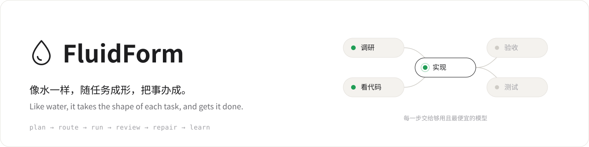
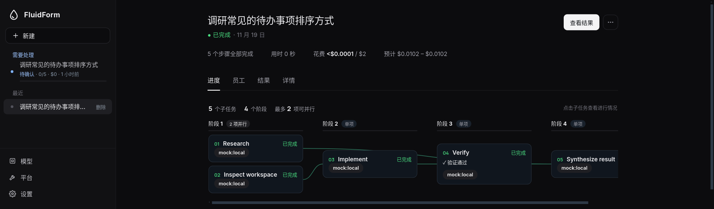
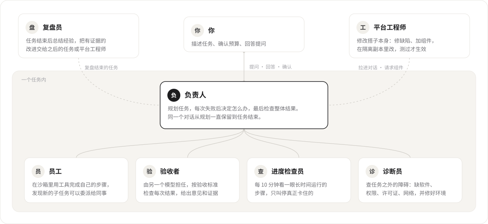
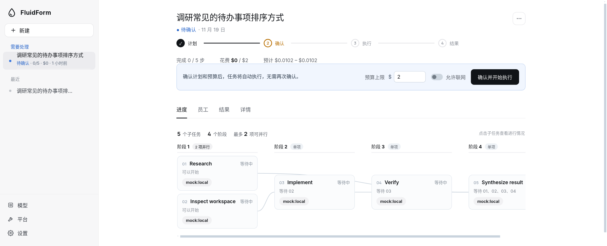
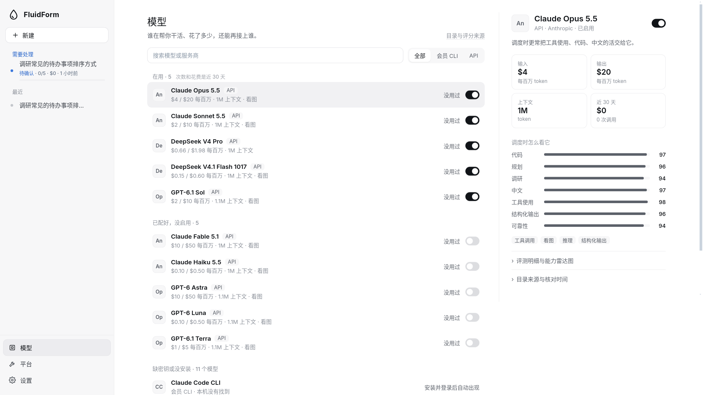
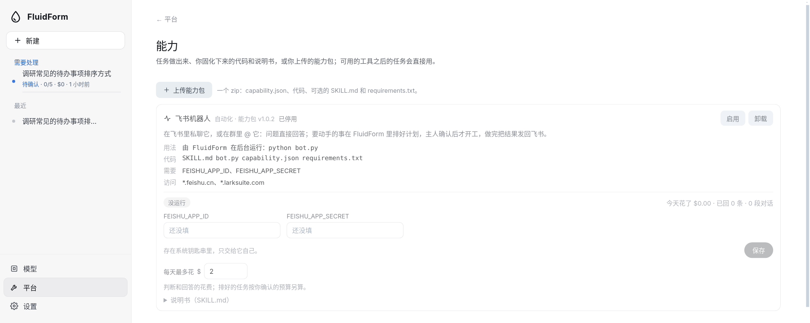

<p align="center"></p>

<p align="center">
  <b>像水一样，随任务成形：一支 AI 模型小队，在你自己的机器上把事办成。</b>
</p>

<p align="center">
  <a href="#快速开始">快速开始</a> ·
  <a href="docs/guide.zh-CN.md">使用手册</a> ·
  <a href="docs/ARCHITECTURE.md">架构</a> ·
  <a href="README.md">English</a>
</p>

<br>

FluidForm（中文名若水）用起来很简单：你描述要做什么，确认一次计划和预算。之后负责人规划、员工分头做、另一个模型逐步验收；遇到障碍，有人诊断、有人修复。团队只在真正需要你的时候回来找你。

<p align="center"></p>

## 亮点

<table>
<tr>
<td width="50%" valign="top">

**确认一次，自己干完**<br>
计划、预算、联网开关一次确认。之后的重试、换模型、改计划都由负责人决定，并写明理由。

</td>
<td width="50%" valign="top">

**每一步用够用且最便宜的模型**<br>
按公开评测成绩挑模型。你已付费的会员 CLI（Claude Code、Codex、Gemini、Qwen）和九家 API 可以混用。

</td>
</tr>
<tr>
<td valign="top">

**换一个模型来验收**<br>
每一步的结果都由另一个模型对照验收标准检查。长时间运行的步骤有人盯着，只叫停真正卡住的。

</td>
<td valign="top">

**会修环境，也会修自己**<br>
缺软件、许可证、端口这类问题由诊断员修。FluidForm 本身的缺陷交给平台工程师，在隔离副本里改，测试通过才生效。

</td>
</tr>
<tr>
<td valign="top">

**能力可插拔**<br>
任务做出的工具可以固化下来。能力包可以单独上传、单独卸载，运行在沙箱里，只能访问它声明过的域名。

</td>
<td valign="top">

**数据留在本机**<br>
只响应本机请求，任务默认不联网。步骤运行在沙箱里，看不到你的主目录。密钥存在系统钥匙串里。

</td>
</tr>
</table>

## 团队

<p align="center"></p>

每个角色由你配置好的模型担任，代码只负责护栏：预算、沙箱与权限、联网开关和重试上限。每个角色怎么工作，见 [使用手册 · 团队成员](docs/guide.zh-CN.md#团队成员)。

## 界面

| 确认一次计划和预算 | 模型：在用、已配好、缺密钥 |
|---|---|
|  |  |

<p align="center"><br><sub>能力：上传能力包、填密钥、启用前确认、卸载</sub></p>

## 快速开始

```bash
git clone https://github.com/mchwang233/super-partner.git
cd super-partner
./start.sh
```

打开 <http://127.0.0.1:5173>。

- **不需要密钥**：内置的离线演示模型就能走完整个流程。
- **接入真实模型**：在 **模型** 页填 API 密钥；会员 CLI 装好并登录后会自动出现。
- **环境要求**：Python 3.9+、Node.js；步骤沙箱需要 Linux 的 bubblewrap。
- **停止**：`./stop.sh`。

也可以用 `docker compose up --build`，或参考 [手动启动](docs/guide.zh-CN.md#手动启动)。

## 文档

- **[使用手册](docs/guide.zh-CN.md)**：每个角色、失败怎么处理、命令行、在已有项目上工作、凭据、模型目录与评分、沙箱与联网、API。
- **[架构](docs/ARCHITECTURE.md)**：模块地图，每项功能在哪个文件、由哪些测试覆盖（英文）。
- **[设计文档](docs/design/)**：负责人、平台工程师、员工团队、能力与能力包等设计说明。
- **[能力包](https://github.com/mchwang233/super-partner/tree/capabilities)**：`capabilities` 分支，可以单独上传的能力包，比如飞书机器人。

## 许可证

MIT，见 [LICENSE](LICENSE)。
